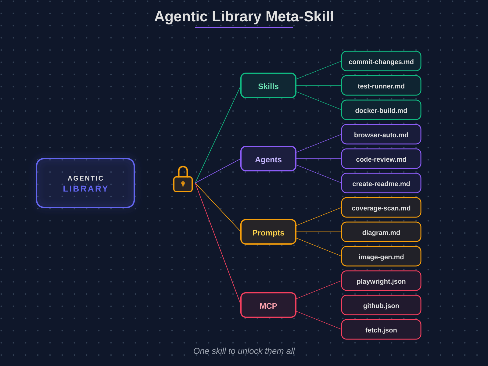
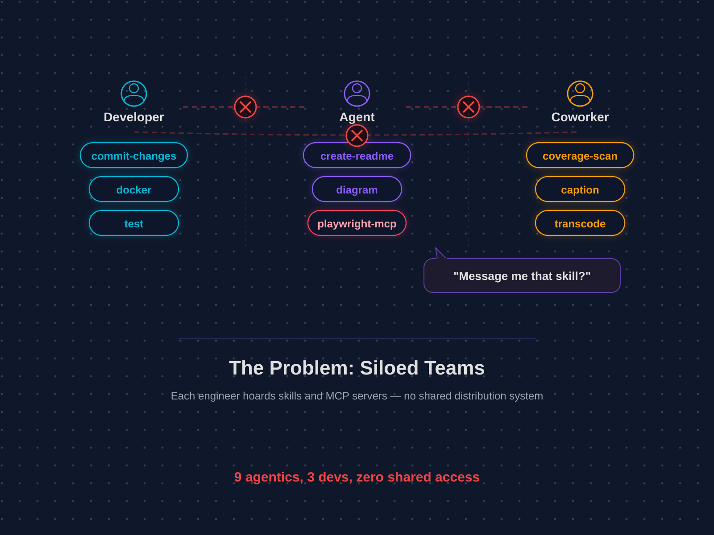
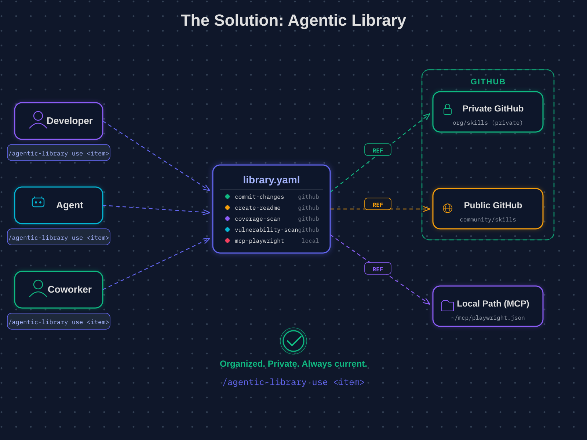
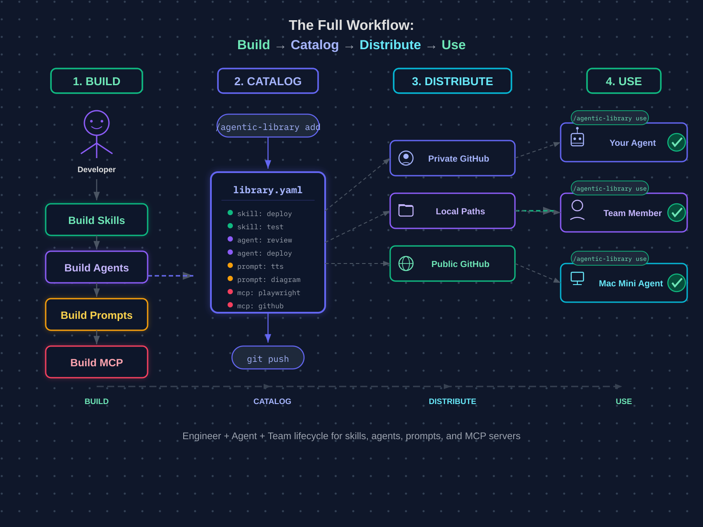
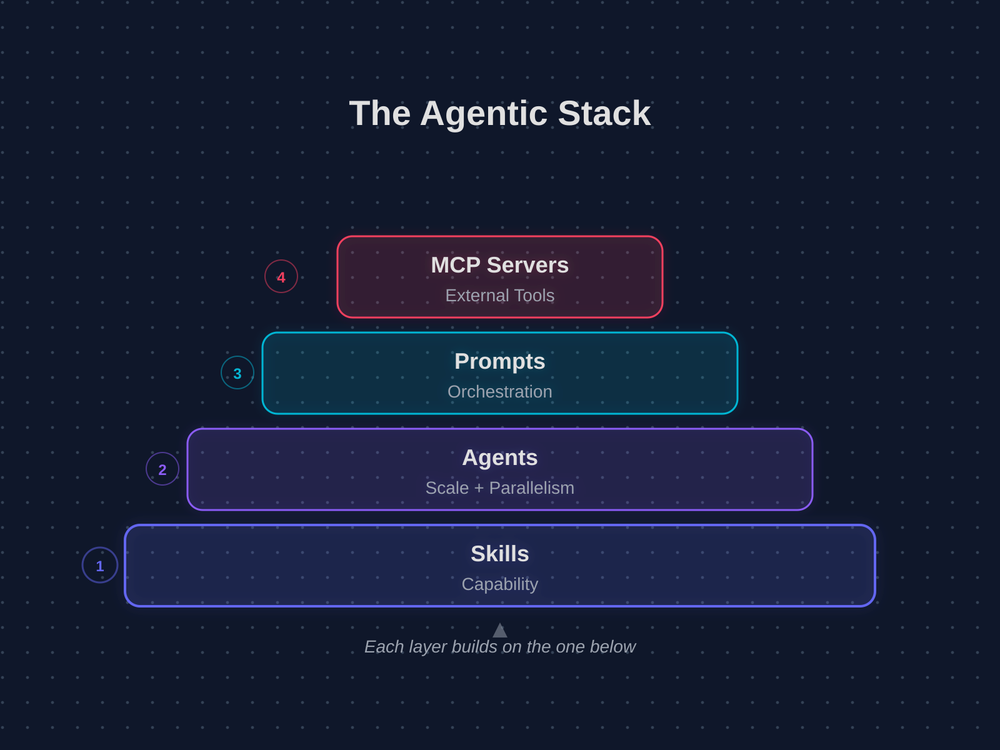

# Agentic Library

Agentic Library is a skill that manages other skills. It shares your private agentics across your agents, devices, and team. An agentic is any capability you give an AI coding agent: a skill, an agent, a prompt, or an MCP server.



Here is what each term means:

- A **skill** is a folder of instructions that teaches an agent one task.
- An **agent** is a specialized AI helper with its own instructions.
- A **prompt** is a saved set of instructions that coordinates skills and agents.
- An **MCP server** (Model Context Protocol server) is a program that gives an agent access to an outside tool or service, such as a database.

## Who This Is For

This is for engineers who work in 10 or more codebases with agents, and who build their own private skills, agents, prompts, and MCP servers.

If you work in one or two repositories (repos, the folders that hold a project's code), you do not need this. It is also not for you if you install skills from the public internet without reviewing them first.

Agentic Library solves one problem. You have built useful agentics in many repos, on many devices, and in many teams. Copies are spread out, they fall out of date, and they are hard to coordinate. Agentic Library gives you one reference catalog, a single list of where your agentics live, so you can share them privately.

## What It Is

Agentic Library is one skill. Its only job is to manage other skills. It keeps a catalog, which is a list of entries that point to where your agentics live. Each entry holds a local file path or a GitHub repo URL. GitHub is a website that hosts code repositories. Nothing is copied or installed until you ask for it.

Think of the catalog as a `package.json` for agent capabilities. A `package.json` is the file that lists the packages a JavaScript project uses. The difference is what the list holds. Instead of packages, the catalog lists skills, agents, prompts, and MCP servers. Instead of a public registry, which is a public list of packages, the catalog points to your own private GitHub repos and local paths.

**This is a pure agent application.** It has no scripts, no command-line tools, no dependencies, and no build tools. The whole application is written in `SKILL.md`, a file of instructions, plus a set of cookbook guides that teach the agent what to do. The agent is the runtime, the program that runs those instructions. This matters because:

- Any agent harness that reads skill files can run it. A harness is the app an agent runs in, such as Claude Code or Pi.
- You change its behavior by editing Markdown, a plain-text format. You do not edit code.
- You can extend, fork (copy and change), and adapt the skill right away.
- An orchestrator agent, one that coordinates other agents, can chain agentic-library commands. It needs no extra tools.

## Why It Exists

As you build with AI agents, you collect skills, custom agents, prompts, and MCP servers. You may end up with hundreds. You need to:

- **Reuse** them across projects without copying and pasting.
- **Distribute** them to agents on other devices, such as a Mac mini or a remote server.
- **Share** them with your team without making them public.
- **Keep them private.** These capabilities are built for your own edge over others.
- **Stay in sync.** Keep one source of truth, not ten old copies.



Existing solutions do not fit:

- **Copying everything into your global `~/.agents/*` folder by hand.** Global means every project on your machine can read the folder. Every agent then sees every agentic, copies fall out of date, and nothing records where they came from. Agentic Library also installs globally by default, for convenience. The difference is that each install comes from a tracked source, and you can limit one install to a single project with `-p`.
- **A single monorepo.** A monorepo is one repository that holds many projects. It does not match how you work. You build agentics in specific codebases for specific uses.

## How It Works



### The Catalog (`library.yaml`)

The catalog is a file named `library.yaml`. It lists each skill, agent, prompt, and MCP server, with a name, a description, and a source. The source is the path or URL where the item lives.

```yaml
default_dirs:
  skills:
    - project: .agents/skills/
    - global: ~/.agents/skills/
  agents:
    - project: .agents/agents/
    - global: ~/.agents/agents/
  prompts:
    - project: .agents/commands/
    - global: ~/.agents/commands/
  mcp:
    - project: .claude/mcp/
    - global: ~/.claude/mcp/

agentic-library:
  skills:
    - name: my-skill
      description: What this skill does
      source: /Users/me/projects/tools/skills/my-skill/SKILL.md
      requires: [agent:helper-agent]
    - name: remote-skill
      description: A skill from a private repo
      source: https://github.com/myorg/private-skills/blob/main/skills/remote-skill/SKILL.md
  agents: []
  prompts: []
  mcp:
    - name: my-mcp
      description: What this MCP server does
      source: /Users/me/projects/tools/mcp/my-mcp/mcp.json
```

The catalog stores pointers, not copies. Skills stay in their source repos. You pull (download) them when you need them.

`library.yaml` is local to each machine. It is gitignored, which means Git, the tool that tracks code changes, ignores it. It is also read-only, so nothing changes it by accident. The repo tracks `library.example.yaml` as the starting template. Install copies that template to `library.yaml` and locks the copy with `chmod 444`, a command that makes a file read-only. The `add` and `remove` commands unlock the file, edit it, and lock it again. They never commit (save a change in Git) or push (upload it to GitHub).

### Source Formats

A source is the address of the file that the catalog points to. Use one of these formats:

| Format             | Example                                                            |
| ------------------ | ------------------------------------------------------------------ |
| Local filesystem   | `/absolute/path/to/SKILL.md`                                       |
| GitHub browser URL | `https://github.com/org/repo/blob/main/path/to/SKILL.md`           |
| GitHub raw URL     | `https://raw.githubusercontent.com/org/repo/main/path/to/SKILL.md` |

The source points to one specific file: `SKILL.md`, `AGENT.md`, a prompt file, or `mcp.json`. The system pulls the whole folder that holds that file. A skill needs more than its `SKILL.md`. Its scripts, reference files, and assets, such as images, come with it.

For private repos, the system signs in automatically with an SSH key or a `GITHUB_TOKEN`. A private repo is one that only approved people can see. An SSH key is a key file on your computer that proves who you are to GitHub. A `GITHUB_TOKEN` is a password-style value that gives access to GitHub.

**The system also registers MCP servers with the harness.** Installing an MCP entry merges its `mcp.json` file into the harness settings. Claude Code is the default harness. For a global install, the settings file is `~/.claude.json`. For a project install, it is `./.mcp.json`. The server is listed under `mcpServers.<name>`. The merge runs in the background, so the server is ready after you restart. Removing an MCP entry unregisters it.

**The system links skills into Claude Code automatically.** Installed skills live in `~/.agents/skills/<name>/`. With `--project`, they live in `.agents/skills/<name>/` instead. The `use` command creates a symlink (a shortcut that points to another folder) at `~/.claude/skills/<name>`, or at `.claude/skills/<name>` for a project. The symlink points to the installed copy. After a restart, Claude Code lists the skill as a slash command, a command you type that starts with `/`. The `/<name>` form is the result. An existing real folder at that path is never overwritten. The `remove` command deletes the symlink along with the skill. Installs to a folder you choose yourself are not linked.

### Typed Dependencies

A dependency is another item that an entry needs to work. Dependencies use typed references, which name the kind of item as well as its name. This avoids mix-ups when two items share a name.

```yaml
requires: [skill:base-utils, agent:reviewer, prompt:task-router, mcp:playwright]
```

The system pulls dependencies first. It also pulls the dependencies of each dependency, down the whole chain.

## Prerequisites

- **Claude Code**, or another agent harness that reads skill files, such as Pi.
- **git**, the version-control tool. You need it to clone the library (copy a repo to your computer) and to pull sources.
- **gh** (optional), the GitHub command-line tool. It helps with forking (making your own copy of a repo on GitHub), cloning, and private repo access. Install it with `brew install gh`, where `brew` is Homebrew, a package manager for macOS and Linux. You can also follow the [gh docs](https://cli.github.com).
- **GitHub SSH key or `GITHUB_TOKEN`**, for private repos. You do not need these if you sign in with `gh auth login`.

## Installation

Clone **Agentic Library** into your global skills folder. After that, you can type `/agentic-library` in any coding agent session.

### 1. Clone to Global Skills Directory

Clone the repo into `~/.agents/skills/agentic-library`. The `~` means your home folder. This path makes `/agentic-library` available as a global skill. Use either command:

```bash
# Using git
mkdir -p ~/.agents/skills/agentic-library
git clone <your-fork-url> ~/.agents/skills/agentic-library

# Or using GitHub CLI
gh repo clone <yourname>/agentic-library ~/.agents/skills/agentic-library
```

If the clone fails, check the URL and your access to the repo. Private repos need an SSH key or a `GITHUB_TOKEN` (see Prerequisites).

Then create your local catalog from the template, and make it read-only:

```bash
cd ~/.agents/skills/agentic-library
cp library.example.yaml library.yaml
chmod 444 library.yaml
```

`library.yaml` is gitignored, so Git does not track it. It stays on this machine.

### 2. Configure Claude Code

Claude Code loads skills from `~/.claude/skills/` (global) or `.claude/skills/` (project). Create a symlink there that points to the cloned skill:

```bash
# Global
mkdir -p ~/.claude/skills
ln -s ~/.agents/skills/agentic-library ~/.claude/skills/agentic-library

# Or project scope (run from your project root)
mkdir -p .claude/skills
ln -s ~/.agents/skills/agentic-library .claude/skills/agentic-library
```

Claude Code then registers the skill as the `/agentic-library` slash command. No command template is needed.

If `/agentic-library` does not appear after you restart Claude Code, check that the symlink exists at the path above.

### 3. Configure

Open `~/.agents/skills/agentic-library/SKILL.md` and find the `## Variables` section. Set `LIBRARY_REPO_URL` to the address of your fork, which is your own copy of the repo on GitHub. The agent reads these variables each time it runs.

```markdown
# Before (template defaults)
- **LIBRARY_REPO_URL**: `<your forked repo url>`

# After (your values)
- **LIBRARY_REPO_URL**: `https://github.com/yourname/agentic-library.git`
```

You only need to change `LIBRARY_REPO_URL`. The other two variables, `LIBRARY_YAML_PATH` and `LIBRARY_SKILL_DIR`, are correct by default if you cloned to `~/.agents/skills/agentic-library/`.

### 4. Verify

Start a new Claude Code session in any folder. Type `/agentic-library list`. It should run and show an empty catalog.

If you see no `/agentic-library` command, check the symlink from step 2, then restart Claude Code.

## Quick Start



The usual workflow is **build → catalog → distribute → use**. You build an agentic in one of your repos, add it to the catalog, distribute it to other places, and use it there.

### Add a skill to the catalog

Say you built a deploy skill, which teaches an agent how to release your app, in one of your repos. Register it in the catalog:

```
/agentic-library add deploy skill from https://github.com/yourorg/infra-tools/blob/main/skills/deploy/SKILL.md
```

This adds a reference to your local `library.yaml`. It unlocks the file for the edit, then locks it again. The catalog stays on each machine and is never committed. Run `add` on every device that should see the entry.

### Use it in another project

On any project, on any machine whose catalog has the entry, run:

```
/agentic-library use deploy
```

This pulls the skill from the source repo into `~/.agents/skills/deploy/` and links it into `~/.claude/skills/deploy`. Claude Code picks it up after a restart. Installs are **global by default**, so every project on this machine can use the skill.

Scope is where an install lives. Global scope makes it available to every project on the machine. Project scope makes it available only to the current project. To limit the install to the current project, add `-p` (or `--project`):

```
/agentic-library use deploy -p    # or --project → .agents/skills/deploy/, linked at .claude/skills/deploy
```

The `-g` flag, or `--global`, selects global scope on purpose. If you pass both `-g` and `-p`, the command fails. Use one. A custom target path overrides either flag. Dependencies install in the same scope as the item that needs them. MCP servers follow the same rule. Global installs go to `~/.claude/mcp/` and register in `~/.claude.json`. Project installs go to `.claude/mcp/` and register in `./.mcp.json`.

### Push changes back

You improved the skill on your machine. Push the update to its source repo, which uploads it to GitHub:

```
/agentic-library push deploy
```

Every device that runs `/agentic-library update` gets the latest version.

If you are not an owner or maintainer of the source repo, you cannot push directly. Open a merge request (called a pull request on GitHub) instead.

### Add a skill from someone else's GitHub repo

Point `add` at a repo. You can give it `owner/repo`, a repo URL, or a `tree/` URL. A `tree/` URL is a GitHub link to a folder inside a repo. The command finds the `SKILL.md`, reads its name and description, and records the entry:

```
/agentic-library add example/skills
/agentic-library use grill-me
```

### Check for and apply updates

`sync` compares what you have installed with the upstream source, the original place the item came from. It changes nothing. `update` pulls the newest version. It warns you first if you edited the installed copy:

```
/agentic-library sync
/agentic-library update grill-me
/agentic-library update --all
```

## Commands

> **Permissions Note:** `push` writes to an item's source repo. Only owners and maintainers of that repo can push directly. Everyone else must open a merge request (pull request). `add` and `remove` only edit your local `library.yaml`.

| Command                     | What It Does                                               | Permissions |
| --------------------------- | ---------------------------------------------------------- | ----------- |
| `/agentic-library install`          | First-time setup: fork, clone, configure                  | All users   |
| `/agentic-library add <details>`    | Register a new entry in your local catalog                 | All users   |
| `/agentic-library use <name> [-g\|-p]` | Pull from source (install or refresh); global by default, `-p` for project | All users   |
| `/agentic-library push <name>`      | Push local changes back to the source                      | Owner / Maintainer (or Merge Request) |
| `/agentic-library remove <name> [-g\|-p]` | Remove from your local catalog and optionally delete the installed copy (global by default) | All users   |
| `/agentic-library list`             | Show full catalog with install status                      | All users   |
| `/agentic-library sync`             | Check installed items for upstream updates (read-only)     | All users   |
| `/agentic-library update <name\|--all>` | Pull the newest upstream version of installed items     | All users   |
| `/agentic-library search <keyword>` | Find entries by name or description                        | All users   |

## Architecture

The skill folder has this layout:

```
~/.agents/skills/agentic-library/     # Agentic Library skill (globally installed)
    SKILL.md                  # Agent instructions, the core of the skill
    library.example.yaml      # Tracked catalog template
    library.yaml              # Your local catalog (gitignored, read-only)
    cookbook/                 # Step-by-step guides for each command
        README.md             # Worked examples for every command
        install.md
        add.md
        use.md
        push.md
        remove.md
        list.md
        sync.md
        update.md
        search.md
    README.md                 # This file
```

## Design Principles

- **Private-first**: Built for your own specialized agentics that give you an edge. It is not a public marketplace.
- **Reference-based**: The catalog stores pointers, not copies. Skills stay in their source repos.
- **Pure agent**: No scripts and no build tools. `SKILL.md` teaches the agent everything it needs to know.
- **Agent-agnostic**: The default target is `~/.agents/skills/` (global, or `.agents/skills/` with `-p`). It also supports any folder, for any agent harness.
- **Catalog, not manifest**: Entries say what is available. They do not say what is installed, which is what a manifest would list. You pull items when you need them.
- **Local catalog**: `library.yaml` is per machine, gitignored, and read-only. Only the `library.example.yaml` template is shared.

## The Agentic Stack



The first four layers are the agentics. Agentic Library is the layer that distributes them.

| Layer           | Purpose                                        |
| --------------- | ---------------------------------------------- |
| **Skills**      | Raw capabilities: what an agent can do         |
| **Agents**      | Scale, parallel work, and specialization       |
| **Prompts**     | Orchestration: coordinate skills and agents    |
| **MCP Servers** | External tools and connections for the harness |
| **Agentic Library** | Distribution across devices, teams, and agents |
